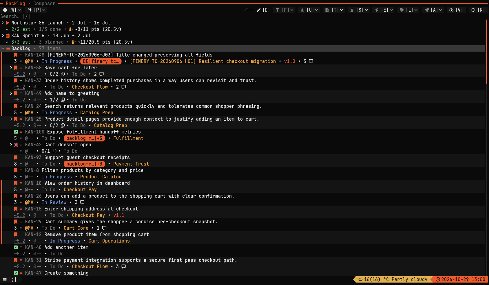
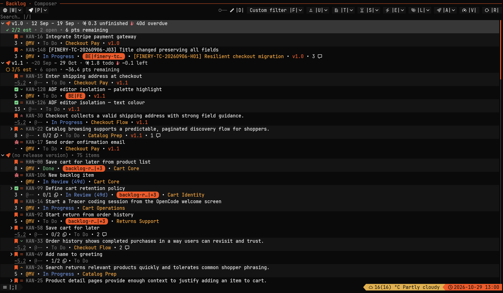
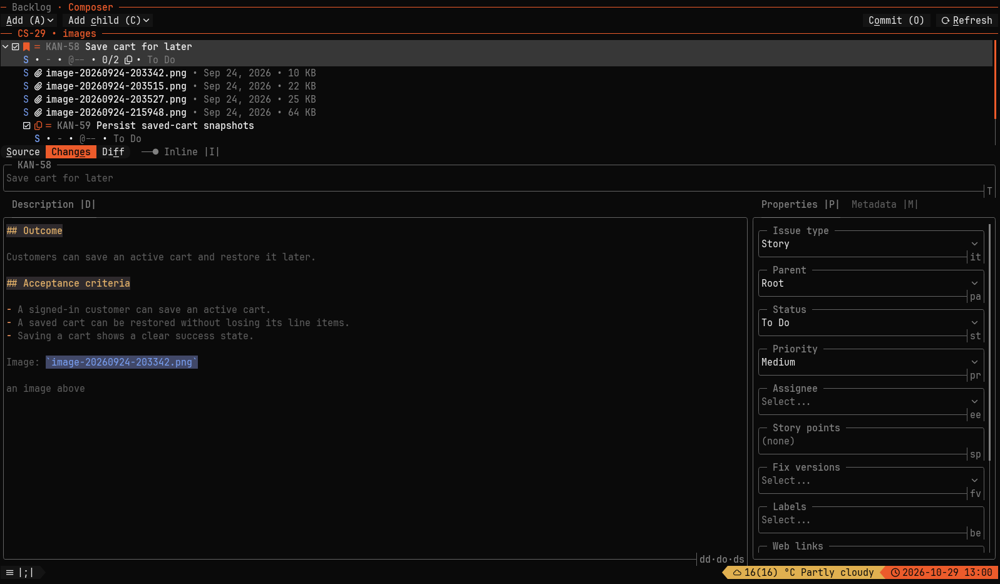
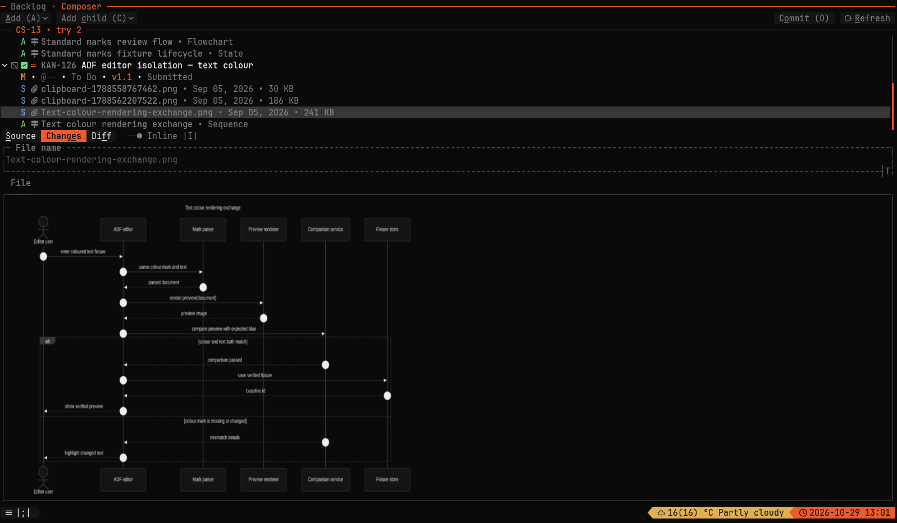

# Finery

MCP-driven Jira planning with a keyboard-first TUI and reviewable local change sets.

[](https://github.com/daure/finery/releases/latest)
[](https://github.com/daure/finery/actions/workflows/release.yml)

[Install](#install) · [Get started](#get-started) · [MCP](#connect-an-agent) · [Reference](docs/reference.md)

Agents use Model Context Protocol (MCP) to query backlog and sprint data, reorder work, and create, edit, or delete local Composer change sets. They can draft and update ticket descriptions, properties, and attachments within those sets. Review proposed changes in the TUI before authorizing submission to Jira.

## Features

- Ticket search, backlog navigation, and sprint planning.
- Local Composer change sets for drafting and editing related tickets.
- MCP access so agents can prepare changes for review in the TUI.

## Screenshots



<sub>Backlog — browse sprint groups and tickets with estimates, status, and labels.</sub>



<sub>Release planning — group tickets by version and track estimates and remaining work.</sub>



<sub>Composer — prepare ticket descriptions and properties in a local change set.</sub>



<sub>Attachments — inspect images alongside the tickets in a change set.</sub>

## Install

Prebuilt binaries support **Ubuntu 24.04+ on x86_64**. Rust is not required.
Use a terminal with a [Nerd Font](https://www.nerdfonts.com/) for icons.

```sh
installer="$(mktemp)"
curl --proto '=https' --tlsv1.2 -LsSf \
  https://github.com/daure/finery/releases/latest/download/finery-installer.sh \
  -o "$installer" && sh "$installer"
rm -f "$installer"
export PATH="${CARGO_HOME:-$HOME/.cargo}/bin:$PATH"
finery
```

Keep the install directory on your shell's PATH. [Manual installation and updates](docs/reference.md#install).

## Get started

1. Open Settings and configure your Jira URL, email, and API token; choose your project and board.
2. Browse your backlog or search for a ticket with `Ctrl+F`.
3. Use Composer to prepare a change set, review its proposed changes, then explicitly submit it to Jira.

Credentials and defaults are stored in Finery's local database. Environment variables can override them; see [configuration](docs/reference.md#development).

## Connect an agent

Configure your MCP client to launch Finery's stdio server:

```json
{
  "command": "finery",
  "args": ["mcp"]
}
```

Review agent-prepared changes in Composer before authorizing submission.
For HTTP or a persistent service, see the [MCP service guide](docs/reference.md#persistent-mcp-service).
HTTP binds to loopback and has no bearer authentication; keep it local.

## Documentation and contributing

- [Installation and updates](docs/reference.md#install) · [Planning and ticket actions](docs/reference.md#release-date-estimates)
- [Composer selection and submission](docs/composer-selection.md) · [Jira description safety](docs/jira-description-support.md)
- [Build from source](docs/reference.md#build-from-source) — Rust and a sibling `../tuicore` checkout
- [Architecture](architecture.md) · [Releasing](docs/reference.md#release) · [Issues](https://github.com/daure/finery/issues)

Close running TUIs before upgrading and back up your database before upgrades or rollbacks.

## License

MIT or Apache-2.0, at your option, as declared in [Cargo.toml](Cargo.toml).
